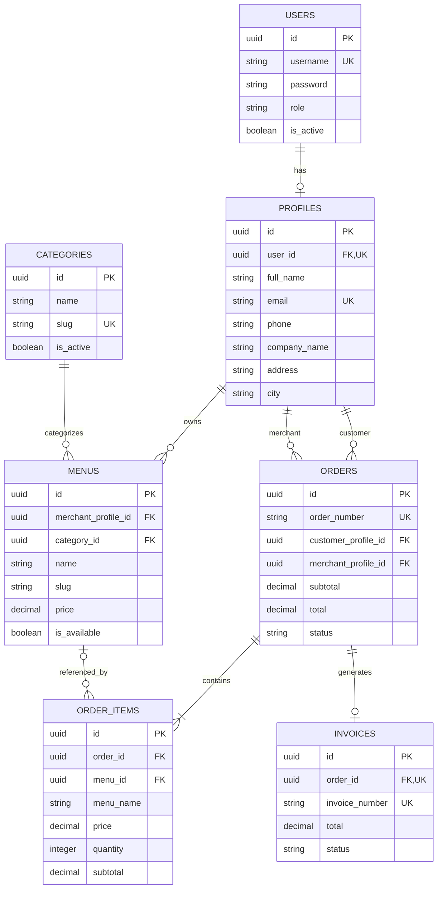

# Marketplace Katering API

Backend REST API untuk aplikasi **Marketplace Katering** yang menghubungkan customer dengan merchant/penyedia jasa katering. Repository ini berfokus pada pengembangan backend menggunakan Laravel, PostgreSQL, Eloquent ORM, dan autentikasi berbasis JWT.

> **Project scope:** Repository ini khusus untuk backend Laravel. Frontend dikembangkan pada aplikasi/repository terpisah.

---

## Table of Contents

- [1. Project Overview](#1-project-overview)
- [2. Technology Stack](#2-technology-stack)
- [3. Architecture](#3-architecture)
- [4. Core Modules](#4-core-modules)
- [5. Database Design](#5-database-design)
  - [5.1 Database Principles](#51-database-principles)
  - [5.2 Users](#52-table-users)
  - [5.3 Profiles](#53-table-profiles)
  - [5.4 Categories](#54-table-categories)
  - [5.5 Menus](#55-table-menus)
  - [5.6 Orders](#56-table-orders)
  - [5.7 Order Items](#57-table-order_items)
  - [5.8 Invoices](#58-table-invoices)
  - [5.9 Entity Relationship Diagram](#59-entity-relationship-diagram)
  - [5.10 Database Integrity and Business Rules](#510-database-integrity-and-business-rules)
- [6. Authentication and Authorization](#6-authentication-and-authorization)
- [7. API Design Convention](#7-api-design-convention)
- [8. Project Structure](#8-project-structure)
- [9. Installation and Configuration](#9-installation-and-configuration)
- [10. Development Workflow](#10-development-workflow)
- [11. Testing](#11-testing)
- [12. Security Guidelines](#12-security-guidelines)
- [13. Development Roadmap](#13-development-roadmap)

---

## 1. Project Overview

Marketplace Katering API menyediakan layanan backend untuk proses marketplace katering, mulai dari pengelolaan akun, profil pengguna, kategori, katalog menu, pemesanan, hingga penerbitan invoice.

Terdapat dua jenis pengguna utama:

- **Merchant:** Pengguna yang menawarkan produk atau layanan katering.
- **Customer:** Pengguna yang mencari dan melakukan pemesanan produk katering.

### Project Goals

- Menyediakan REST API yang konsisten untuk aplikasi marketplace katering.
- Memisahkan kredensial autentikasi dari informasi profil pengguna.
- Mengelola katalog menu milik merchant.
- Mendukung proses pemesanan customer kepada merchant.
- Menyimpan histori transaksi dengan snapshot harga dan nama menu.
- Menjaga integritas data melalui relasi, constraint, dan transaksi database.

---

## 2. Technology Stack

| Component | Technology |
|---|---|
| Backend Framework | Laravel |
| Programming Language | PHP |
| Database | PostgreSQL |
| ORM | Laravel Eloquent |
| API Style | REST API |
| Response Format | JSON |
| Authentication | JWT |
| Testing | Pest / PHPUnit |
| Dependency Manager | Composer |
| Version Control | Git & GitHub |

Versi Laravel dan PHP mengikuti versi stabil yang kompatibel dengan dependency project pada saat instalasi. Versi aktual dapat diperiksa melalui `php artisan --version` dan `php -v`.

---

## 3. Architecture

Project menggunakan pendekatan **Modular Monolith**.

Setiap domain bisnis dikelompokkan berdasarkan tanggung jawabnya, tetapi seluruh modul tetap berada dalam satu aplikasi Laravel dan satu deployment backend.

### Architectural Principles

1. **Separation of Concerns** — Controller, Service, Model, Request, dan Resource memiliki tanggung jawab masing-masing.
2. **Domain-oriented modules** — Fitur dikelompokkan berdasarkan domain bisnis.
3. **Reusable business logic** — Aturan bisnis ditempatkan pada Service Layer, bukan ditumpuk di Controller.
4. **Database integrity** — Foreign key, unique constraint, index, dan transaction digunakan sesuai kebutuhan.
5. **API consistency** — Response API menggunakan format JSON yang konsisten.

### Request Flow

```text
Client
  |
  v
API Route
  |
  v
Middleware (Authentication / Authorization)
  |
  v
Form Request (Validation)
  |
  v
Controller
  |
  v
Service Layer (Business Logic)
  |
  v
Eloquent Model
  |
  v
PostgreSQL
  |
  v
API Resource / JSON Response
```

Modular Monolith dipilih agar struktur aplikasi tetap terorganisasi tanpa menambah kompleksitas operasional microservices pada tahap awal.

---

## 4. Core Modules

| Module | Responsibility |
|---|---|
| Authentication | Register, login, logout, token refresh, dan identitas pengguna |
| User & Profile | Pengelolaan akun, role, dan informasi profil |
| Category | Pengelolaan kategori menu |
| Menu Management | Pengelolaan menu katering milik merchant |
| Marketplace Catalog | Menampilkan dan mencari katalog menu |
| Order Management | Pembuatan dan pengelolaan pesanan |
| Invoice Management | Penerbitan dan pengelolaan invoice |

### Module Scope

#### Authentication
- Register akun.
- Login menggunakan username dan password.
- Logout / invalidasi token sesuai mekanisme JWT yang digunakan.
- Refresh token apabila didukung konfigurasi JWT.
- Mengambil informasi pengguna yang sedang login.

#### User & Profile
- Mengelola username dan status akun.
- Mengelola role `merchant` dan `customer`.
- Mengelola nama lengkap, email, nomor telepon, dan informasi profil.
- Menyimpan informasi usaha untuk profile merchant.

#### Category
- Membuat dan mengubah kategori.
- Mengaktifkan atau menonaktifkan kategori.
- Menentukan urutan tampilan kategori.

#### Menu Management
- Merchant membuat, mengubah, dan mengelola menu.
- Menu terhubung dengan kategori.
- Merchant mengatur ketersediaan menu.
- Menu mendukung soft delete.

#### Marketplace Catalog
- Menampilkan kategori dan menu yang tersedia.
- Menampilkan detail menu dan informasi merchant.
- Menyediakan pencarian dan filter katalog sesuai kebutuhan API.

#### Order Management
- Customer membuat pesanan kepada satu merchant.
- Pesanan memiliki satu atau lebih item.
- Backend menghitung subtotal dan total.
- Merchant mengelola status pesanan sesuai aturan transisi.

#### Invoice Management
- Membuat invoice berdasarkan order.
- Menjaga nomor invoice tetap unik.
- Menyimpan status invoice dan waktu pembayaran.
- Integrasi payment gateway berada di luar cakupan modul invoice awal.

---

## 5. Database Design

### 5.1 Database Principles

Database menggunakan PostgreSQL dengan Eloquent ORM.

Standar database:

- Seluruh primary key tabel bisnis menggunakan **UUID v7**.
- Seluruh foreign key tabel bisnis menggunakan UUID.
- UUID disimpan menggunakan native UUID type PostgreSQL.
- Tabel `users` hanya menyimpan kredensial autentikasi dan role.
- Tabel `profiles` menyimpan informasi lengkap pengguna.
- Seluruh nominal uang menggunakan `DECIMAL(14,2)`.
- Foreign key, unique constraint, dan index diterapkan sesuai kebutuhan.
- Tabel bisnis menggunakan `created_at` dan `updated_at`.
- Laravel migrations menjadi sumber utama perubahan skema database.

> UUID v7 digunakan untuk identifier yang lebih sulit ditebak dibandingkan integer berurutan dan memiliki karakteristik timestamp ordering. UUID bukan pengganti authentication maupun authorization.

### 5.2 Table `users`

Menyimpan informasi autentikasi dan otorisasi pengguna.

| Column | Type | Constraint | Description |
|---|---|---|---|
| id | UUID | PK | User identifier |
| username | VARCHAR(50) | UNIQUE, NOT NULL | Username untuk login |
| password | VARCHAR | NOT NULL | Hashed password |
| role | VARCHAR(20) | INDEX, NOT NULL | `merchant` / `customer` |
| is_active | BOOLEAN | DEFAULT TRUE | Account status |
| created_at | TIMESTAMP | | Creation time |
| updated_at | TIMESTAMP | | Last update |

Catatan:
- Password harus disimpan dalam bentuk hash.
- Username digunakan sebagai identifier login.
- Email tidak disimpan pada tabel users, melainkan pada profiles.

### 5.3 Table `profiles`

Menyimpan informasi lengkap pengguna. Setiap user memiliki maksimal satu profile.

| Column | Type | Constraint | Description |
|---|---|---|---|
| id | UUID | PK | Profile identifier |
| user_id | UUID | FK, UNIQUE | Reference to `users.id` |
| full_name | VARCHAR(150) | NOT NULL | Full name |
| email | VARCHAR | UNIQUE | Email address |
| phone | VARCHAR(20) | NOT NULL | Contact number |
| company_name | VARCHAR | NULL | Company or catering name |
| contact_person | VARCHAR | NULL | Company contact person |
| address | TEXT | NULL | Address |
| city | VARCHAR(100) | NULL | City |
| description | TEXT | NULL | Profile description |
| logo | VARCHAR | NULL | Logo or profile image path |
| created_at | TIMESTAMP | | Creation time |
| updated_at | TIMESTAMP | | Last update |

Fields related to company information may be NULL depending on the user's role. Validasi kelengkapan profil dilakukan berdasarkan role pada application layer.

### 5.4 Table `categories`

Stores master categories for catering menus.

| Column | Type | Constraint | Description |
|---|---|---|---|
| id | UUID | PK | Category identifier |
| name | VARCHAR(100) | NOT NULL | Category name |
| slug | VARCHAR(120) | UNIQUE | URL-friendly identifier |
| description | TEXT | NULL | Category description |
| is_active | BOOLEAN | DEFAULT TRUE | Category status |
| sort_order | SMALLINT | DEFAULT 0 | Display ordering |
| created_at | TIMESTAMP | | Creation time |
| updated_at | TIMESTAMP | | Last update |

### 5.5 Table `menus`

Stores catering products owned by merchants.

| Column | Type | Constraint | Description |
|---|---|---|---|
| id | UUID | PK | Menu identifier |
| merchant_profile_id | UUID | FK | Reference to `profiles.id` |
| category_id | UUID | FK | Reference to `categories.id` |
| name | VARCHAR(150) | NOT NULL | Menu name |
| slug | VARCHAR(180) | NOT NULL | Menu slug |
| description | TEXT | NULL | Menu description |
| photo | VARCHAR | NULL | Menu image path |
| price | DECIMAL(14,2) | NOT NULL | Menu price |
| is_available | BOOLEAN | DEFAULT TRUE | Availability |
| created_at | TIMESTAMP | | Creation time |
| updated_at | TIMESTAMP | | Last update |
| deleted_at | TIMESTAMP | NULL | Soft delete timestamp |

Constraints and indexes:
- `UNIQUE(merchant_profile_id, slug)`
- Index `(merchant_profile_id, is_available)`
- Index `(category_id, is_available)`

Menu menggunakan soft delete untuk menjaga histori dan referensi transaksi.

### 5.6 Table `orders`

Stores order transaction headers.

| Column | Type | Constraint | Description |
|---|---|---|---|
| id | UUID | PK | Order identifier |
| order_number | VARCHAR(50) | UNIQUE | Order reference |
| customer_profile_id | UUID | FK | Customer profile |
| merchant_profile_id | UUID | FK | Merchant profile |
| delivery_date | DATE | NOT NULL | Delivery date |
| delivery_address | TEXT | NOT NULL | Delivery address snapshot |
| subtotal | DECIMAL(14,2) | DEFAULT 0 | Order subtotal |
| total | DECIMAL(14,2) | DEFAULT 0 | Final order total |
| status | VARCHAR(30) | DEFAULT `pending` | Order status |
| notes | TEXT | NULL | Additional notes |
| created_at | TIMESTAMP | | Creation time |
| updated_at | TIMESTAMP | | Last update |

Order status:
- `pending`
- `confirmed`
- `preparing`
- `delivered`
- `cancelled`

Indexes:
- `(customer_profile_id, status)`
- `(merchant_profile_id, status)`
- `delivery_date`

Business rule: satu order hanya ditujukan kepada satu merchant. Jika customer memesan dari beberapa merchant, setiap merchant memperoleh order terpisah.

### 5.7 Table `order_items`

Stores individual menu items in an order.

| Column | Type | Constraint | Description |
|---|---|---|---|
| id | UUID | PK | Order item identifier |
| order_id | UUID | FK | Reference to `orders.id` |
| menu_id | UUID | FK, NULL | Reference to `menus.id` |
| menu_name | VARCHAR(150) | NOT NULL | Menu name snapshot |
| price | DECIMAL(14,2) | NOT NULL | Price snapshot |
| quantity | INTEGER | NOT NULL | Ordered quantity |
| subtotal | DECIMAL(14,2) | NOT NULL | Item subtotal |
| created_at | TIMESTAMP | | Creation time |
| updated_at | TIMESTAMP | | Last update |

Menu name dan price disimpan sebagai snapshot untuk menjaga histori transaksi meskipun data menu berubah. Jika menu dihapus permanen, `menu_id` menjadi NULL sedangkan snapshot transaksi tetap tersedia.

### 5.8 Table `invoices`

Stores invoices generated from orders.

| Column | Type | Constraint | Description |
|---|---|---|---|
| id | UUID | PK | Invoice identifier |
| order_id | UUID | FK, UNIQUE | Reference to `orders.id` |
| invoice_number | VARCHAR(50) | UNIQUE | Invoice reference |
| invoice_date | DATE | NOT NULL | Invoice date |
| subtotal | DECIMAL(14,2) | NOT NULL | Invoice subtotal |
| total | DECIMAL(14,2) | NOT NULL | Invoice total |
| status | VARCHAR(30) | DEFAULT `issued` | Invoice status |
| paid_at | TIMESTAMP | NULL | Payment timestamp |
| created_at | TIMESTAMP | | Creation time |
| updated_at | TIMESTAMP | | Last update |

Invoice status:
- `issued`
- `paid`
- `cancelled`

Satu order maksimal memiliki satu invoice. Payment processing dan payment gateway berada di luar cakupan invoice module awal.

### 5.9 Entity Relationship Diagram



### 5.10 Database Integrity and Business Rules

1. All business tables use UUID v7 primary keys.
2. Foreign keys use PostgreSQL UUID type.
3. Each user can have a maximum of one profile.
4. User role determines Merchant or Customer access.
5. Profile fields are validated according to user role.
6. A merchant can own multiple menus.
7. Each menu belongs to one category.
8. Each order belongs to one customer and one merchant.
9. All items in an order must belong to the same merchant.
10. Order items preserve menu name and price snapshots.
11. Order totals are calculated on the backend.
12. One order can generate a maximum of one invoice.
13. Menu uses soft deletes to preserve historical references.
14. Foreign keys, unique constraints, and indexes maintain data integrity.
15. Database transactions are used for checkout and invoice generation.
16. Laravel migrations are the source of truth for schema changes.

---

## 6. Authentication and Authorization

Authentication menggunakan JWT (JSON Web Token).

### Login Credentials

- `username`
- `password`

Email merupakan informasi pada `profiles`, bukan identifier login.

### Authentication Flow

```text
Register
   |
   v
Create User (username, hashed password, role)
   |
   v
Create Profile (email and user details)
   |
   v
Login using username/password
   |
   v
Validate credentials
   |
   v
Issue JWT
   |
   v
Access protected API
```

### Authorization

Role utama:
- `merchant`
- `customer`

Authorization wajib memeriksa role dan kepemilikan resource. UUID yang sulit ditebak tidak menggantikan pemeriksaan authorization.

### JWT Implementation Notes

- Password tidak pernah dikembalikan pada API response.
- Token harus memiliki masa berlaku.
- Secret/key JWT disimpan pada environment variable.
- Refresh dan revocation mengikuti library JWT yang dipilih.
- JWT subject harus mengidentifikasi user secara konsisten menggunakan UUID user ID, bukan mengekspos username sebagai pengganti primary key.

---

## 7. API Design Convention

API menggunakan RESTful convention dan JSON.

### Base URL

```text
/api/v1
```

### Endpoint Groups

Endpoint berikut merupakan rancangan resource API yang akan diimplementasikan bertahap.

| Module | Method | Endpoint | Description |
|---|---|---|---|
| Authentication | POST | `/auth/register` | Register account |
| Authentication | POST | `/auth/login` | Login |
| Authentication | POST | `/auth/logout` | Logout |
| Authentication | POST | `/auth/refresh` | Refresh token |
| Authentication | GET | `/auth/me` | Current user |
| Profile | GET | `/profile` | Get profile |
| Profile | PUT | `/profile` | Update profile |
| Categories | GET | `/categories` | List categories |
| Categories | GET | `/categories/{id}` | Category detail |
| Menus | GET | `/menus` | Browse menus |
| Menus | GET | `/menus/{id}` | Menu detail |
| Menus | POST | `/merchant/menus` | Create menu |
| Menus | PUT | `/merchant/menus/{id}` | Update menu |
| Menus | DELETE | `/merchant/menus/{id}` | Delete menu |
| Orders | POST | `/orders` | Create order |
| Orders | GET | `/orders` | List user's orders |
| Orders | GET | `/orders/{id}` | Order detail |
| Orders | PATCH | `/merchant/orders/{id}/status` | Update order status |
| Invoices | GET | `/invoices/{id}` | Invoice detail |

### Standard Success Response

```json
{
  "success": true,
  "message": "Data retrieved successfully",
  "data": {}
}
```

### Standard Error Response

```json
{
  "success": false,
  "message": "Validation failed",
  "errors": {}
}
```

HTTP status code harus digunakan sesuai kondisi, misalnya `200`, `201`, `400`, `401`, `403`, `404`, `422`, dan `500`.

---

## 8. Project Structure

Aplikasi Laravel berada di dalam folder `backend/`.

```text
marketplace-katering-api/
├── backend/
│   ├── app/
│   │   ├── Http/
│   │   │   ├── Controllers/
│   │   │   ├── Middleware/
│   │   │   ├── Requests/
│   │   │   └── Resources/
│   │   ├── Models/
│   │   ├── Providers/
│   │   └── Services/
│   ├── bootstrap/
│   ├── config/
│   ├── database/
│   │   ├── factories/
│   │   ├── migrations/
│   │   └── seeders/
│   ├── routes/
│   │   └── api.php
│   ├── tests/
│   │   ├── Feature/
│   │   └── Unit/
│   ├── .env.example
│   ├── artisan
│   ├── composer.json
│   └── phpunit.xml
└── README.md
```

Struktur dapat berkembang mengikuti kebutuhan modul. Pengelompokan folder tidak boleh mengaburkan tanggung jawab Controller, Service, Request, Resource, dan Model.

---

## 9. Installation and Configuration

### Prerequisites

Pastikan perangkat pengembangan memiliki:
- PHP yang kompatibel dengan versi Laravel project.
- Composer.
- PostgreSQL.
- Git.

### Clone Repository

```bash
git clone https://github.com/StackOverfloweds/marketplace-katering-api.git
cd marketplace-katering-api
```

### Install Laravel Dependencies

```bash
cd backend
composer install
```

Jika aplikasi Laravel belum dibuat, inisialisasi dari root repository:

```bash
composer create-project laravel/laravel backend
```

### Environment Configuration

```bash
cp .env.example .env
php artisan key:generate
```

Atur koneksi PostgreSQL pada file `.env`:

```dotenv
APP_NAME="Marketplace Katering"
APP_ENV=local
APP_DEBUG=true
APP_URL=http://127.0.0.1:8000

DB_CONNECTION=pgsql
DB_HOST=127.0.0.1
DB_PORT=5432
DB_DATABASE=marketplace_katering
DB_USERNAME=katering_app
DB_PASSWORD=your_secure_password
```

Buat role dan database PostgreSQL (sesuaikan password):

```sql
CREATE ROLE katering_app
WITH LOGIN PASSWORD 'your_secure_password';

CREATE DATABASE marketplace_katering
OWNER katering_app
ENCODING 'UTF8';
```

### Run Migrations

```bash
php artisan config:clear
php artisan migrate
```

### Run Seeders

```bash
php artisan db:seed
```

Untuk menjalankan migration dan seeder sekaligus pada database development kosong:

```bash
php artisan migrate:fresh --seed
```

> **Warning:** `migrate:fresh` menghapus seluruh tabel pada database yang dipilih. Jangan jalankan pada database yang berisi data penting.

### Run Development Server

```bash
php artisan serve
```

Default URL:

```text
http://127.0.0.1:8000
```

---

## 10. Development Workflow

Project menggunakan Git branching workflow berikut:

```text
main
  ^
  | promote after staging approval
  |
staging
  ^
  | promote after development validation
  |
ondev
  ^
  | Pull Request
  |
onfeature/<feature-name>
```

### Branch Responsibilities

| Branch | Responsibility |
|---|---|
| `main` | Production-ready code |
| `staging` | Testing and QA |
| `ondev` | Integration and development |
| `onfeature/*` | Individual feature development |

### Feature Development Flow

1. Ambil perubahan terbaru dari `ondev`.
2. Buat branch baru dengan prefix `onfeature/`.
3. Implementasikan satu fitur dalam branch tersebut.
4. Jalankan test dan pemeriksaan lokal.
5. Push branch dan buat Pull Request menuju `ondev`.
6. Setelah integrasi dan pengujian development berhasil, promosikan `ondev` ke `staging`.
7. Setelah pengujian staging disetujui, promosikan `staging` ke `main`.

### Example

```bash
git fetch origin
git switch ondev
git pull --ff-only origin ondev

git switch -c onfeature/setup-database

# Implement feature
git add .
git commit -m "feat(database): setup database schema"

git push -u origin onfeature/setup-database
```

### Branch Naming Convention

Gunakan nama branch yang deskriptif:

```text
onfeature/setup-database
onfeature/authentication
onfeature/user-profile
onfeature/category-management
onfeature/menu-management
onfeature/marketplace-catalog
onfeature/order-management
onfeature/invoice-management
```

### Commit Message Convention

Gunakan format:

```text
<type>(<scope>): <description>
```

Contoh:
- `feat(auth): implement JWT authentication`
- `feat(menu): add merchant menu management`
- `fix(order): validate order ownership`
- `docs(database): update database schema documentation`
- `test(order): add order service tests`
- `refactor(profile): simplify profile service`

Hindari push langsung ke `main`, `staging`, atau `ondev` untuk perubahan fitur. Gunakan Pull Request agar perubahan dapat ditinjau.

---

## 11. Testing

Testing menggunakan Pest atau PHPUnit sesuai konfigurasi project.

### Run All Tests

```bash
php artisan test
```

### Run Specific Test

```bash
php artisan test --filter=AuthenticationTest
```

### Testing Scope

- Authentication dan validasi kredensial.
- Role-based authorization.
- Profile ownership.
- Category CRUD.
- Menu ownership dan availability.
- Order creation dan perhitungan total.
- Order status transitions.
- Invoice generation.
- Database relationships dan constraints.

Gunakan database testing terpisah dari database development. Jangan menjalankan test yang melakukan reset database pada database yang berisi data penting.

---

## 12. Security Guidelines

1. Simpan password menggunakan hashing Laravel.
2. Jangan mengembalikan password atau secret pada API response.
3. Gunakan JWT dengan masa berlaku yang sesuai.
4. Simpan secret dan credential pada environment variable.
5. Jangan commit file `.env`.
6. Validasi seluruh input menggunakan Form Request atau mekanisme validasi yang konsisten.
7. Terapkan authorization berdasarkan role dan kepemilikan resource.
8. Jangan menganggap UUID sebagai pengganti authorization.
9. Gunakan Eloquent binding dan hindari raw SQL yang tidak aman.
10. Gunakan database transaction untuk operasi multi-tabel yang harus atomik.
11. Batasi akses CORS sesuai kebutuhan aplikasi.
12. Gunakan HTTPS pada deployment.
13. Jangan menampilkan detail exception internal pada production.
14. Pastikan log tidak menyimpan password, token, atau informasi rahasia.

---

## 13. Development Roadmap

Pengembangan dilakukan secara bertahap melalui feature branch.

| Phase | Feature | Scope |
|---|---|---|
| 1 | Setup Database | Laravel setup, PostgreSQL, UUID migrations, models, factories, seeders |
| 2 | Authentication | Register, login, JWT, logout, refresh |
| 3 | User & Profile | Profile management dan role authorization |
| 4 | Category Management | Category CRUD |
| 5 | Menu Management | Merchant menu CRUD |
| 6 | Marketplace Catalog | Public catalog, search, dan filter |
| 7 | Order Management | Checkout, order items, dan status |
| 8 | Invoice Management | Invoice generation dan status |
| 9 | Integration & Hardening | Integrasi modul, security review, dan regression testing |

Setiap phase dikembangkan dalam branch `onfeature/<feature-name>`, kemudian melalui `ondev`, `staging`, dan `main`.

---

## License

License belum ditentukan.
